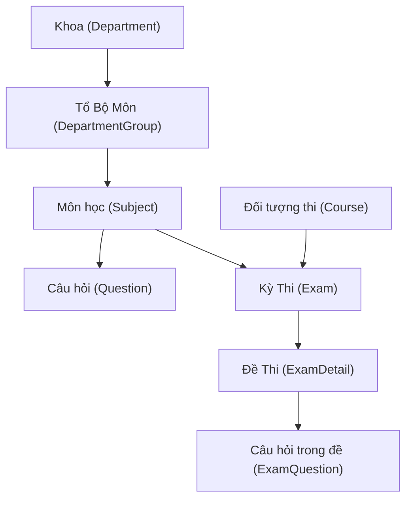
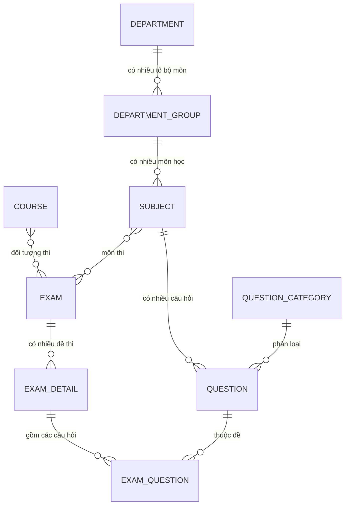

# 📋 Kế Hoạch Phát Triển - Hệ Thống Tạo Đề Thi

> **Stack**: Spring Boot 3.x (Backend) + React 18 TypeScript (Frontend)
> **Database**: PostgreSQL
> **Project**: Standalone mới, tách biệt khỏi dblab-assignment
> **Auth**: ❌ KHÔNG CÓ — Single user, không login/logout
> **Tham chiếu**: Cấu trúc dựa trên [dblab-assignment](file:///d:/DATN/DATN%20D21/dblab-assignment/src) (Backend) và [dblab-web](file:///d:/DATN/DATN%20D21/dblab-web/src) (Frontend)

---

## 1. Tổng Quan Nghiệp Vụ

### 1.1. Mô tả hệ thống
Hệ thống web **đơn người dùng** (single-user, không cần auth) để quản lý và tự động sinh đề thi cho đơn vị đào tạo quân sự. Hỗ trợ:
- **Quản lý ngân hàng câu hỏi** (nhập từ file Word/Excel)
- **Tạo kỳ thi** và tự động **sinh N đề thi** không trùng lặp
- **Xuất file Word/Excel** chia trang A4 thành 4 phần, mỗi phần 1 đề, có đường cắt nét đứt

### 1.2. Cấu trúc đề thi (3 loại)

| # | Cấu trúc | Mô tả |
|---|----------|-------|
| 1 | **Lý thuyết + Thực hành** | N câu lý thuyết + M câu thực hành (tùy chỉnh) |
| 2 | **Tự luận** | N câu tự luận (tùy chỉnh) |
| 3 | **Lý thuyết + Thực hành + Tình huống** | N câu LT + M câu TH + K câu tình huống (tùy chỉnh) |

> [!NOTE]
> Số lượng câu hỏi mỗi loại trong cấu trúc đề có thể **tùy chỉnh** bởi user khi tạo kỳ thi.

### 1.3. Phân cấp tổ chức



### 1.4. Đối tượng thi (Course)

Đối tượng thi tượng trưng cho nhóm thí sinh, ví dụ:
- Tiểu đội trưởng
- Sỹ quan dự bị
- Hạ sỹ quan

---

## 2. Thiết Kế Database

### 2.1. Những gì ĐÃ BỎ so với dblab-assignment

> [!WARNING]
> Các thành phần sau **KHÔNG CÓ** trong project này:
> - ❌ **SysUser entity** — Không có người dùng, single-user
> - ❌ **Auth/Security** — Không có login, logout, JWT, Spring Security
> - ❌ **Semester entity** — Không liên kết kỳ thi với học kỳ
> - ❌ **createdBy / lastModifiedBy** trong BaseEntity — Không có user để track

### 2.2. BaseEntity (Đơn giản hóa)

```java
@MappedSuperclass
@Getter
@Setter
public abstract class BaseEntity {
    @Id
    @GeneratedValue(strategy = GenerationType.UUID)
    private UUID id;

    @Column(name = "created_at", updatable = false)
    @CreationTimestamp
    private LocalDateTime createdAt;

    @Column(name = "updated_at")
    @UpdateTimestamp
    private LocalDateTime updatedAt;
}
```

> [!IMPORTANT]
> BaseEntity chỉ có 3 field: `id` (UUID auto-gen), `createdAt`, `updatedAt`.
> **KHÔNG CÓ** `createdBy`, `lastModifiedBy` vì không có hệ thống user.

### 2.3. Entity Relationship Diagram



### 2.4. Chi tiết các Entity

#### 2.4.1. Department (Khoa)

```java
@Entity
@Table(name = "eg_department")
public class Department extends BaseEntity {
    @Column(nullable = false, unique = true, length = 50)
    private String code;        // Mã khoa: CNTT, QS...

    @Column(nullable = false)
    private String name;        // Tên khoa

    @Column(columnDefinition = "TEXT")
    private String description;

    @Column(name = "is_active", nullable = false)
    private Boolean isActive = true;

    @OneToMany(mappedBy = "department", cascade = CascadeType.ALL)
    private List<DepartmentGroup> groups;
}
```

#### 2.4.2. DepartmentGroup (Tổ Bộ Môn)

```java
@Entity
@Table(name = "eg_department_group")
public class DepartmentGroup extends BaseEntity {
    @Column(nullable = false, unique = true, length = 50)
    private String code;

    @Column(nullable = false)
    private String name;

    @Column(columnDefinition = "TEXT")
    private String description;

    @ManyToOne(fetch = FetchType.LAZY)
    @JoinColumn(name = "department_id", nullable = false)
    private Department department;

    @OneToMany(mappedBy = "departmentGroup", cascade = CascadeType.ALL)
    private List<Subject> subjects;

    @Column(name = "is_active", nullable = false)
    private Boolean isActive = true;
}
```

#### 2.4.3. Subject (Môn học)

```java
@Entity
@Table(name = "eg_subject")
public class Subject extends BaseEntity {
    @Column(nullable = false, unique = true)
    private String subjectCode;

    @Column(nullable = false)
    private String subjectName;

    @Column(columnDefinition = "TEXT")
    private String description;

    @ManyToOne(fetch = FetchType.LAZY)
    @JoinColumn(name = "department_group_id")
    private DepartmentGroup departmentGroup;

    @OneToMany(mappedBy = "subject")
    private List<Question> questions;
}
```

#### 2.4.4. QuestionCategory (Phân loại câu hỏi)

```java
@Entity
@Table(name = "eg_question_category")
public class QuestionCategory extends BaseEntity {
    @Column(nullable = false, unique = true)
    private String code;  // LY_THUYET, THUC_HANH, TU_LUAN, TINH_HUONG

    @Column(nullable = false)
    private String name;  // Lý thuyết, Thực hành, Tự luận, Tình huống

    @OneToMany(mappedBy = "category")
    private List<Question> questions;
}
```

> [!IMPORTANT]
> Các giá trị category **cố định** cần seed vào DB khi khởi tạo:
> | Code | Name |
> |------|------|
> | `LY_THUYET` | Lý thuyết |
> | `THUC_HANH` | Thực hành |
> | `TU_LUAN` | Tự luận |
> | `TINH_HUONG` | Tình huống |

#### 2.4.5. Question (Câu hỏi)

```java
@Entity
@Table(name = "eg_question")
public class Question extends BaseEntity {
    @Column(columnDefinition = "TEXT", nullable = false)
    private String content;

    private Double score;

    @Enumerated(EnumType.STRING)
    @Column(nullable = false)
    private QuestionType type;     // LY_THUYET, THUC_HANH, TU_LUAN, TINH_HUONG

    @Enumerated(EnumType.STRING)
    private DifficultyLevel difficultyLevel;  // EASY, MEDIUM, HARD

    private String mediaUrl;

    @Column(unique = true)
    private String code;           // Mã câu hỏi (auto-gen hoặc nhập tay)

    @ManyToOne(fetch = FetchType.LAZY)
    @JoinColumn(name = "category_id")
    private QuestionCategory category;

    @ManyToOne(fetch = FetchType.LAZY)
    @JoinColumn(name = "subject_id", nullable = false)
    private Subject subject;

    @Column(columnDefinition = "TEXT")
    private String answer;         // Đáp án (cho tự luận)

    @Column(name = "is_active", nullable = false)
    private Boolean isActive = true;
}
```

#### 2.4.6. Course (Đối tượng thi)

```java
@Entity
@Table(name = "eg_course")
public class Course extends BaseEntity {
    @Column(nullable = false, unique = true)
    private String courseCode;     // TDT, SQDB...

    @Column(nullable = false)
    private String name;           // Tiểu đội trưởng, Sỹ quan dự bị

    @Column(columnDefinition = "TEXT")
    private String description;

    @Column(name = "is_active", nullable = false)
    private Boolean isActive = true;
}
```

#### 2.4.7. Exam (Kỳ thi)

```java
@Entity
@Table(name = "eg_exam")
public class Exam extends BaseEntity {
    @Column(unique = true)
    private String code;           // Mã kỳ thi (auto-gen)

    @Column(nullable = false)
    private String title;

    @Column(columnDefinition = "TEXT")
    private String description;

    private int totalExamSets;     // Số lượng đề sinh ra
    private int duration;          // Thời gian làm bài (phút)

    @Enumerated(EnumType.STRING)
    @Column(nullable = false)
    private ExamStructureType structureType;

    @Enumerated(EnumType.STRING)
    @Column(nullable = false)
    private ExamStatus status = ExamStatus.DRAFT;

    @ManyToOne(fetch = FetchType.LAZY)
    @JoinColumn(name = "subject_id", nullable = false)
    private Subject subject;

    @ManyToOne(fetch = FetchType.LAZY)
    @JoinColumn(name = "course_id")
    private Course course;

    private LocalDateTime examDate;

    @OneToMany(mappedBy = "exam", cascade = CascadeType.ALL, orphanRemoval = true)
    private List<ExamDetail> examDetails;
}
```

> [!NOTE]
> So với plan cũ: **ĐÃ BỎ** field `semester` (ManyToOne Semester). Kỳ thi chỉ có `examDate` để ghi nhận ngày thi.

#### 2.4.8. ExamDetail (Đề thi cụ thể)

```java
@Entity
@Table(name = "eg_exam_detail")
public class ExamDetail extends BaseEntity {
    @ManyToOne(fetch = FetchType.LAZY)
    @JoinColumn(name = "exam_id", nullable = false)
    private Exam exam;

    private String examSetCode;    // Đề 1, Đề 2... hoặc A, B, C...
    private int orderNumber;

    @OneToMany(mappedBy = "examDetail", cascade = CascadeType.ALL, orphanRemoval = true)
    private List<ExamQuestion> questions;
}
```

#### 2.4.9. ExamQuestion (Câu hỏi trong đề)

```java
@Entity
@Table(name = "eg_exam_question")
public class ExamQuestion extends BaseEntity {
    private int sectionOrder;

    @Enumerated(EnumType.STRING)
    private QuestionType questionType;

    @ManyToOne(fetch = FetchType.LAZY)
    @JoinColumn(name = "exam_detail_id", nullable = false)
    private ExamDetail examDetail;

    @ManyToOne(fetch = FetchType.LAZY)
    @JoinColumn(name = "question_id", nullable = false)
    private Question question;
}
```

### 2.5. Enum Definitions

```java
public enum QuestionType {
    LY_THUYET,    // Lý thuyết
    THUC_HANH,    // Thực hành
    TU_LUAN,      // Tự luận
    TINH_HUONG    // Tình huống
}

public enum DifficultyLevel {
    EASY, MEDIUM, HARD
}

public enum ExamStructureType {
    THEORY_PRACTICE,              // N câu LT + M câu TH
    ESSAY,                        // N câu TL
    THEORY_PRACTICE_SITUATION     // N câu LT + M câu TH + K câu TH(tình huống)
}

public enum ExamStatus {
    DRAFT,       // Nháp - chưa sinh đề
    GENERATED,   // Đã sinh đề
    EXPORTED     // Đã xuất file
}
```

---

## 3. Backend Architecture (Spring Boot)

### 3.1. Cấu trúc Package

```
src/main/java/com/example/examgenerator/
├── ExamGeneratorApplication.java
├── config/
│   ├── CorsConfig.java            // CORS cho frontend
│   └── WebMvcConfig.java
├── controller/
│   ├── DepartmentController.java
│   ├── DepartmentGroupController.java
│   ├── SubjectController.java
│   ├── CourseController.java
│   ├── QuestionCategoryController.java
│   ├── QuestionController.java
│   ├── ExamController.java
│   └── ExportController.java
├── dto/
│   ├── request/
│   │   ├── DepartmentRequest.java
│   │   ├── DepartmentGroupRequest.java
│   │   ├── SubjectRequest.java
│   │   ├── CourseRequest.java
│   │   ├── QuestionRequest.java
│   │   ├── ExamCreateRequest.java
│   │   └── GenerateExamRequest.java
│   └── response/
│       ├── ApiResponse.java           // Wrapper response chung
│       ├── DepartmentResponse.java
│       ├── DepartmentGroupResponse.java
│       ├── SubjectResponse.java
│       ├── CourseResponse.java
│       ├── QuestionResponse.java
│       ├── ExamResponse.java
│       ├── ExamDetailResponse.java
│       └── ImportResultResponse.java
├── entity/
│   ├── BaseEntity.java               // Chỉ id + createdAt + updatedAt
│   ├── Department.java
│   ├── DepartmentGroup.java
│   ├── Subject.java
│   ├── Course.java
│   ├── QuestionCategory.java
│   ├── Question.java
│   ├── Exam.java
│   ├── ExamDetail.java
│   └── ExamQuestion.java
├── enumerate/
│   ├── QuestionType.java
│   ├── DifficultyLevel.java
│   ├── ExamStructureType.java
│   └── ExamStatus.java
├── exception/
│   ├── GlobalExceptionHandler.java
│   ├── ResourceNotFoundException.java
│   └── InsufficientQuestionsException.java
├── mapper/
│   ├── DepartmentMapper.java
│   ├── QuestionMapper.java
│   └── ExamMapper.java
├── repository/
│   ├── DepartmentRepository.java
│   ├── DepartmentGroupRepository.java
│   ├── SubjectRepository.java
│   ├── CourseRepository.java
│   ├── QuestionCategoryRepository.java
│   ├── QuestionRepository.java
│   ├── ExamRepository.java
│   ├── ExamDetailRepository.java
│   └── ExamQuestionRepository.java
├── service/
│   ├── DepartmentService.java
│   ├── DepartmentGroupService.java
│   ├── SubjectService.java
│   ├── CourseService.java
│   ├── QuestionCategoryService.java
│   ├── QuestionService.java
│   ├── QuestionImportService.java       // Import Word/Excel
│   ├── ExamService.java
│   ├── ExamGeneratorService.java        // ★ Thuật toán sinh đề
│   └── ExamExportService.java           // ★ Xuất file Word/Excel
└── util/
    ├── ExcelParserUtil.java
    └── WordExportUtil.java
```

> [!NOTE]
> **KHÔNG CÓ** các file/folder sau (so với dblab-assignment):
> - ❌ `config/SecurityConfig.java` — Không có auth
> - ❌ `config/MinioConfig.java` — Không cần object storage giai đoạn này
> - ❌ `entity/SysUser.java` — Không có user
> - ❌ `entity/Semester.java` — Không cần
> - ❌ `service/MinioService.java` — Không cần
> - ❌ `lib/token-manager.ts` (frontend) — Không có JWT

### 3.2. API Endpoints

#### 3.2.1. Department (Khoa)

| Method | Endpoint | Mô tả |
|--------|----------|-------|
| `GET` | `/api/departments` | Lấy danh sách khoa |
| `GET` | `/api/departments/{id}` | Chi tiết 1 khoa |
| `POST` | `/api/departments` | Tạo khoa mới |
| `PUT` | `/api/departments/{id}` | Cập nhật khoa |
| `DELETE` | `/api/departments/{id}` | Xóa khoa |

#### 3.2.2. DepartmentGroup (Tổ Bộ Môn)

| Method | Endpoint | Mô tả |
|--------|----------|-------|
| `GET` | `/api/department-groups` | Lấy tất cả |
| `GET` | `/api/department-groups?departmentId=` | Lọc theo khoa |
| `POST` | `/api/department-groups` | Tạo mới |
| `PUT` | `/api/department-groups/{id}` | Cập nhật |
| `DELETE` | `/api/department-groups/{id}` | Xóa |

#### 3.2.3. Subject (Môn học)

| Method | Endpoint | Mô tả |
|--------|----------|-------|
| `GET` | `/api/subjects` | Lấy tất cả |
| `GET` | `/api/subjects?groupId=` | Lọc theo tổ bộ môn |
| `POST` | `/api/subjects` | Tạo mới |
| `PUT` | `/api/subjects/{id}` | Cập nhật |
| `DELETE` | `/api/subjects/{id}` | Xóa |

#### 3.2.4. Course (Đối tượng thi)

| Method | Endpoint | Mô tả |
|--------|----------|-------|
| `GET` | `/api/courses` | Lấy tất cả |
| `POST` | `/api/courses` | Tạo mới |
| `PUT` | `/api/courses/{id}` | Cập nhật |
| `DELETE` | `/api/courses/{id}` | Xóa |

#### 3.2.5. QuestionCategory (Phân loại)

| Method | Endpoint | Mô tả |
|--------|----------|-------|
| `GET` | `/api/question-categories` | Lấy tất cả (seed data) |

#### 3.2.6. Question (Câu hỏi) ★

| Method | Endpoint | Mô tả |
|--------|----------|-------|
| `GET` | `/api/questions?page=&size=&subjectId=&type=&level=&search=` | Pagination + filters |
| `GET` | `/api/questions/{id}` | Chi tiết |
| `POST` | `/api/questions` | Tạo câu hỏi |
| `PUT` | `/api/questions/{id}` | Cập nhật |
| `DELETE` | `/api/questions` | Xóa nhiều (body: list IDs) |
| `POST` | `/api/questions/import` | **Import từ file Excel/Word** (multipart) |
| `GET` | `/api/questions/template` | Tải file mẫu import |
| `GET` | `/api/questions/count?subjectId=&type=` | Đếm câu hỏi khả dụng (cho sinh đề) |

#### 3.2.7. Exam (Kỳ thi & Sinh đề) ★★★

| Method | Endpoint | Mô tả |
|--------|----------|-------|
| `GET` | `/api/exams` | Lấy tất cả kỳ thi |
| `GET` | `/api/exams/{id}` | Chi tiết kỳ thi |
| `POST` | `/api/exams` | Tạo kỳ thi mới (DRAFT) |
| `PUT` | `/api/exams/{id}` | Cập nhật thông tin |
| `DELETE` | `/api/exams/{id}` | Xóa kỳ thi |
| `POST` | `/api/exams/{id}/generate` | **★ Sinh N đề thi** |
| `GET` | `/api/exams/{id}/details` | Xem danh sách đề đã sinh |
| `GET` | `/api/exams/{id}/details/{detailId}` | Xem chi tiết 1 đề |
| `POST` | `/api/exams/{id}/regenerate` | Xóa đề cũ và sinh lại |
| `GET` | `/api/exams/{id}/export/word` | **★ Xuất file Word** |
| `GET` | `/api/exams/{id}/export/excel` | **★ Xuất file Excel** |

### 3.3. Thuật Toán Sinh Đề ★★★

#### Input (GenerateExamRequest):
```json
{
  "numberOfSets": 5,
  "questionConfig": [
    { "questionType": "LY_THUYET", "count": 3 },
    { "questionType": "THUC_HANH", "count": 2 }
  ]
}
```

> `questionConfig` cho phép user tùy chỉnh số câu hỏi mỗi loại.

#### Logic (ExamGeneratorService):

```
1. Lấy Exam → lấy subjectId
2. Với mỗi entry trong questionConfig:
   a. Query câu hỏi: WHERE subject_id = ? AND type = ? AND is_active = true
   b. Validate: pool.size ≥ numberOfSets × entry.count
      - Nếu ko đủ → throw InsufficientQuestionsException (ghi rõ loại nào thiếu bao nhiêu)
3. Shuffle mỗi pool (Fisher-Yates / Collections.shuffle)
4. Xóa ExamDetail cũ nếu có (regenerate)
5. Với mỗi đề i (0..numberOfSets-1):
   a. Tạo ExamDetail { examSetCode: "Đề " + (i+1), orderNumber: i+1 }
   b. Với mỗi loại câu hỏi, lấy slice tiếp theo từ pool:
      - offset = i * count
      - questions = pool.subList(offset, offset + count)
   c. Tạo ExamQuestion cho mỗi câu
6. Cập nhật exam.status = GENERATED, exam.totalExamSets = numberOfSets
```

### 3.4. Import Câu Hỏi từ File

#### Định dạng file Excel mẫu (.xlsx):

| STT | Mã câu hỏi | Nội dung | Loại câu | Độ khó | Đáp án | Điểm |
|-----|-------------|----------|----------|--------|--------|------|
| 1 | LT001 | Trình bày khái niệm... | LY_THUYET | MEDIUM | ... | 3.0 |
| 2 | TH001 | Thực hiện bài tập... | THUC_HANH | HARD | ... | 4.0 |

#### Thư viện:

```xml
<dependency>
    <groupId>org.apache.poi</groupId>
    <artifactId>poi-ooxml</artifactId>
    <version>5.2.5</version>
</dependency>
```

### 3.5. Xuất File Word/Excel (4 đề/trang A4 Portrait)

#### Layout 1 trang A4 (Portrait — dọc):

```
┌─────────────────────────────────────┐
│          ĐỀ 1 (1/4 trang)          │
│  Câu 1 (LT): ...                   │
│  Câu 2 (TH): ...                   │
├ ─ ─ ─ ─ ─ ─ ─ ─ ─ ─ ─ ─ ─ ─ ─ ─ ─┤  ← đường cắt dashed
│          ĐỀ 2 (1/4 trang)          │
├ ─ ─ ─ ─ ─ ─ ─ ─ ─ ─ ─ ─ ─ ─ ─ ─ ─┤  ← đường cắt dashed
│          ĐỀ 3 (1/4 trang)          │
├ ─ ─ ─ ─ ─ ─ ─ ─ ─ ─ ─ ─ ─ ─ ─ ─ ─┤  ← đường cắt dashed
│          ĐỀ 4 (1/4 trang)          │
└─────────────────────────────────────┘
```

> Cả Word và Excel đều dùng layout này. Apache POI cho cả 2 format.

---

## 4. Frontend Architecture (React + TypeScript)

### 4.1. Cấu trúc thư mục

```
src/
├── App.tsx                         // Router (KHÔNG CÓ auth guard)
├── main.tsx                        // Entry point
├── index.css                       // TailwindCSS + shadcn CSS vars
├── app/                            // Pages
│   ├── dashboard/
│   │   └── page.tsx
│   ├── department/
│   │   └── page.tsx
│   ├── department-group/
│   │   └── page.tsx
│   ├── subject/
│   │   └── page.tsx
│   ├── course/
│   │   └── page.tsx
│   ├── question/
│   │   ├── list/page.tsx
│   │   ├── create/page.tsx
│   │   ├── edit/page.tsx
│   │   └── import/page.tsx
│   ├── exam/
│   │   ├── list/page.tsx
│   │   ├── create/page.tsx
│   │   └── detail/page.tsx         // Chi tiết + sinh đề + export
│   └── question-category/
│       └── page.tsx
├── components/
│   ├── layout/
│   │   ├── MainLayout.tsx          // Sidebar + Header + Content
│   │   ├── AppSidebar.tsx
│   │   └── SiteHeader.tsx
│   ├── department/
│   │   ├── DepartmentTable.tsx
│   │   └── DepartmentForm.tsx
│   ├── subject/
│   │   ├── SubjectTable.tsx
│   │   └── SubjectForm.tsx
│   ├── course/
│   │   ├── CourseTable.tsx
│   │   └── CourseForm.tsx
│   ├── question/
│   │   ├── QuestionTable.tsx
│   │   ├── QuestionForm.tsx
│   │   ├── QuestionImport.tsx
│   │   └── QuestionFilter.tsx
│   ├── exam/
│   │   ├── ExamTable.tsx
│   │   ├── ExamForm.tsx
│   │   ├── ExamGenerator.tsx       // ★ UI sinh đề (wizard)
│   │   ├── ExamPreview.tsx         // ★ Preview đề đã sinh
│   │   └── ExamExport.tsx          // ★ Nút xuất file
│   ├── theme/
│   │   └── theme-provider.tsx
│   └── ui/                         // shadcn/ui (copy từ dblab-web)
│       ├── button.tsx
│       ├── card.tsx
│       ├── dialog.tsx
│       ├── input.tsx
│       ├── select.tsx
│       ├── sidebar.tsx
│       ├── table.tsx
│       ├── tabs.tsx
│       ├── toast.tsx
│       └── ...
├── hooks/
│   ├── useDebounce.ts
│   └── usePagination.ts
├── lib/
│   ├── utils.ts                    // cn() helper
│   └── api.ts                      // Axios instance (không có token)
├── services/
│   ├── departmentService.ts
│   ├── departmentGroupService.ts
│   ├── subjectService.ts
│   ├── courseService.ts
│   ├── questionService.ts
│   ├── questionCategoryService.ts
│   ├── examService.ts
│   └── exportService.ts
├── types/
│   ├── department.ts
│   ├── departmentGroup.ts
│   ├── subject.ts
│   ├── course.ts
│   ├── question.ts
│   ├── questionCategory.ts
│   ├── exam.ts
│   └── common.ts                   // ApiResponse<T>, Pagination, etc.
└── utils/
    ├── formatters.ts
    └── validators.ts
```

> [!NOTE]
> **KHÔNG CÓ** (so với dblab-web):
> - ❌ `app/auth/` — Không có login/register page
> - ❌ `components/auth/` — Không có auth guard
> - ❌ `contexts/AuthContext.tsx` — Không có auth context
> - ❌ `contexts/UserContext.tsx` — Không có user context
> - ❌ `hooks/useAuth.ts` — Không có auth hook
> - ❌ `lib/token-manager.ts` — Không có JWT token
> - ❌ `services/authService.ts` — Không có auth API

### 4.2. Routing (KHÔNG CÓ auth guard)

```typescript
// App.tsx
<BrowserRouter>
  <Routes>
    <Route path="/" element={<MainLayout><Dashboard /></MainLayout>} />
    <Route path="/departments" element={<MainLayout><DepartmentPage /></MainLayout>} />
    <Route path="/department-groups" element={<MainLayout><DepartmentGroupPage /></MainLayout>} />
    <Route path="/subjects" element={<MainLayout><SubjectPage /></MainLayout>} />
    <Route path="/courses" element={<MainLayout><CoursePage /></MainLayout>} />
    <Route path="/question-categories" element={<MainLayout><CategoryPage /></MainLayout>} />
    <Route path="/questions" element={<MainLayout><QuestionListPage /></MainLayout>} />
    <Route path="/questions/create" element={<MainLayout><CreateQuestionPage /></MainLayout>} />
    <Route path="/questions/edit/:id" element={<MainLayout><EditQuestionPage /></MainLayout>} />
    <Route path="/questions/import" element={<MainLayout><ImportQuestionPage /></MainLayout>} />
    <Route path="/exams" element={<MainLayout><ExamListPage /></MainLayout>} />
    <Route path="/exams/create" element={<MainLayout><CreateExamPage /></MainLayout>} />
    <Route path="/exams/:examId" element={<MainLayout><ExamDetailPage /></MainLayout>} />
  </Routes>
</BrowserRouter>
```

### 4.3. Styling — TailwindCSS + shadcn/ui

Giữ nguyên CSS variables từ [index.css](file:///d:/DATN/DATN%20D21/dblab-web/src/index.css). Màu chủ đạo **trắng**.

```css
@layer base {
  :root {
    --background: 0 0% 100%;          /* Trắng */
    --foreground: 222.2 84% 4.9%;     /* Gần đen */
    --primary: 222.2 47.4% 11.2%;     /* Xanh navy đậm */
    --secondary: 210 40% 96.1%;       /* Xám rất nhạt */
  }
}
```

### 4.4. TypeScript Types

```typescript
// types/common.ts
export interface ApiResponse<T> {
  status: number;
  message: string;
  data: T;
  timestamp: string;
}

export interface PageResponse<T> {
  content: T[];
  totalElements: number;
  totalPages: number;
  number: number;
  size: number;
}

// types/question.ts
export type QuestionType = 'LY_THUYET' | 'THUC_HANH' | 'TU_LUAN' | 'TINH_HUONG';
export type DifficultyLevel = 'EASY' | 'MEDIUM' | 'HARD';

export interface Question {
  id: string;
  code: string;
  content: string;
  type: QuestionType;
  difficultyLevel: DifficultyLevel;
  score: number;
  answer?: string;
  mediaUrl?: string;
  categoryId: string;
  categoryName: string;
  subjectId: string;
  subjectName: string;
  isActive: boolean;
  createdAt: string;
  updatedAt: string;
}

// types/exam.ts
export type ExamStructureType = 'THEORY_PRACTICE' | 'ESSAY' | 'THEORY_PRACTICE_SITUATION';
export type ExamStatus = 'DRAFT' | 'GENERATED' | 'EXPORTED';

export interface Exam {
  id: string;
  code: string;
  title: string;
  description?: string;
  totalExamSets: number;
  duration: number;
  structureType: ExamStructureType;
  status: ExamStatus;
  subjectId: string;
  subjectName: string;
  courseId?: string;
  courseName?: string;
  examDate?: string;
  examDetails?: ExamDetail[];
  createdAt: string;
  updatedAt: string;
}

export interface ExamDetail {
  id: string;
  examSetCode: string;
  orderNumber: number;
  questions: ExamQuestion[];
}

export interface ExamQuestion {
  id: string;
  sectionOrder: number;
  questionType: QuestionType;
  question: Question;
}

export interface GenerateExamRequest {
  numberOfSets: number;
  questionConfig: { questionType: QuestionType; count: number }[];
}
```

---

## 5. 🚀 IMPLEMENTATION PHASES

> [!IMPORTANT]
> Mỗi phase dưới đây là **độc lập** và có thể giao cho 1 AI agent implement.
> Phase sau phụ thuộc vào phase trước. **Phải hoàn thành đúng thứ tự.**

---

### PHASE 1: Project Setup & Foundation

**Mục tiêu**: Tạo project backend + frontend chạy được, kết nối DB, có layout cơ bản.

#### Backend tasks:
1. **Init Spring Boot project** (Maven, Java 17+, Spring Boot 3.x)
   - Group: `com.example`, Artifact: `exam-generator`
   - Dependencies: `spring-boot-starter-web`, `spring-boot-starter-data-jpa`, `spring-boot-starter-validation`, `postgresql`, `lombok`
2. **Tạo `application.yml`**: config PostgreSQL, port 8080, JPA ddl-auto=update
3. **Tạo `BaseEntity.java`**: CHỈ `id` (UUID), `createdAt`, `updatedAt` — **KHÔNG CÓ** createdBy/lastModifiedBy
4. **Tạo `CorsConfig.java`**: Allow all origins cho dev (`http://localhost:5173`)
5. **Tạo tất cả enum**: `QuestionType`, `DifficultyLevel`, `ExamStructureType`, `ExamStatus`
6. **Tạo tất cả entity**: Department, DepartmentGroup, Subject, QuestionCategory, Question, Course, Exam, ExamDetail, ExamQuestion (đúng như mục 2.4)
7. **Tạo `ApiResponse.java`** wrapper DTO
8. **Tạo `GlobalExceptionHandler.java`** với `@RestControllerAdvice`
9. **Chạy test**: App start thành công, tables tạo trong PostgreSQL

#### Frontend tasks:
1. **Init Vite project**: `npx -y create-vite@latest ./ --template react-ts`
2. **Setup TailwindCSS v3** + PostCSS + Autoprefixer
3. **Setup shadcn/ui**: init + copy `cn()` util + copy components ui từ dblab-web (button, card, dialog, input, select, table, sidebar, tabs, toast, label, separator, badge, dropdown-menu, form, checkbox, popover, command, scroll-area, skeleton, sheet, avatar, tooltip, breadcrumb)
4. **Tạo `index.css`**: copy CSS variables từ dblab-web (white theme)
5. **Tạo `lib/api.ts`**: Axios instance trỏ tới `http://localhost:8080/api` — **KHÔNG CÓ** token interceptor
6. **Tạo `MainLayout.tsx`**: Sidebar + Header + Content area (tham chiếu [MainLayout.tsx](file:///d:/DATN/DATN%20D21/dblab-web/src/layouts/MainLayout.tsx))
7. **Tạo `AppSidebar.tsx`**: Menu items cho tất cả trang (Dashboard, Khoa, Tổ BM, Môn, Đối tượng, Câu hỏi, Kỳ thi)
8. **Tạo `SiteHeader.tsx`**: Header đơn giản với title
9. **Tạo `App.tsx`**: Router với tất cả routes (KHÔNG CÓ auth guard)
10. **Tạo tất cả `types/`**: department.ts, departmentGroup.ts, subject.ts, course.ts, question.ts, exam.ts, common.ts
11. **Tạo Dashboard placeholder page**
12. **Chạy test**: `npm run dev`, mở browser thấy layout + sidebar hoạt động

#### Deliverables:
- Backend chạy port 8080, DB connected, tables created
- Frontend chạy port 5173, layout + sidebar + routing hoạt động
- Tất cả types đã define

---

### PHASE 2: Master Data CRUD (Khoa, Tổ BM, Môn, Đối tượng thi, Phân loại)

**Mục tiêu**: CRUD hoàn chỉnh cho các entity master data.

#### Backend tasks (cho MỖI entity: Department, DepartmentGroup, Subject, Course):
1. **Repository**: Extend `JpaRepository<Entity, UUID>`, thêm custom queries nếu cần (VD: `findByDepartmentId`)
2. **DTO Request**: class với validation (`@NotBlank`, `@Size`)
3. **DTO Response**: class flatten (VD: departmentName thay vì nested object)
4. **Mapper**: Entity ↔ DTO mapping (có thể dùng manual hoặc MapStruct)
5. **Service**: CRUD logic + validation business rules
6. **Controller**: REST endpoints theo mục 3.2

Riêng **QuestionCategory**:
1. **Repository + Service**: Chỉ GET (read-only)
2. **Data seeder**: `@Component` implements `CommandLineRunner` hoặc `data.sql` để seed 4 category cố định (LY_THUYET, THUC_HANH, TU_LUAN, TINH_HUONG)
3. **Controller**: Chỉ GET endpoint

#### Frontend tasks (cho MỖI entity):
1. **Service**: API calls (CRUD) dùng axios instance
2. **Page component**: Bảng danh sách + nút Thêm/Sửa/Xóa
3. **Table component**: Hiển thị data với shadcn Table
4. **Form component**: Dialog form với shadcn Dialog + Form + Input + Select
5. **Toast notifications**: Thành công/thất bại

Riêng **DepartmentGroup**: Form phải có dropdown chọn Department.
Riêng **Subject**: Form phải có dropdown chọn DepartmentGroup.

#### Deliverables:
- 5 CRUD modules hoạt động đầy đủ (Create, Read, Update, Delete)
- UI bảng + form dialog cho từng module
- Data flow: Frontend → API → DB → Response

---

### PHASE 3: Question Management (CRUD + Filters)

**Mục tiêu**: Quản lý câu hỏi với pagination, filter, search, tạo/sửa/xóa.

#### Backend tasks:
1. **QuestionRepository**: Custom query với `@Query` hỗ trợ filter by `subjectId`, `type`, `difficultyLevel`, `search` (tìm trong content/code) + Pageable
2. **QuestionRequest DTO**: subjectId, categoryId, content, type, difficultyLevel, score, answer, code
3. **QuestionResponse DTO**: Flatten với subjectName, categoryName
4. **QuestionMapper**
5. **QuestionService**: CRUD + paginated search + delete multiple + auto-gen code (nếu code null)
6. **QuestionController**: Endpoints theo mục 3.2.6
7. **API count endpoint**: `GET /api/questions/count?subjectId=&type=` — đếm câu hỏi active (dùng cho Phase 5)

#### Frontend tasks:
1. **questionService.ts**: API calls (get paginated, create, update, delete multiple, count)
2. **QuestionFilter.tsx**: Bộ lọc: Select Môn + Select Loại + Select Độ khó + Search input
3. **QuestionTable.tsx**: Bảng với pagination, checkbox multi-select, nút xóa nhiều
4. **QuestionForm.tsx**: Dialog form: textarea cho content, select cho type/level/subject/category, input score
5. **QuestionListPage**: Trang chính kết hợp Filter + Table + nút "Thêm câu hỏi", "Import", link đến Create
6. **CreateQuestionPage / EditQuestionPage**: Full page form
7. **Delete confirmation dialog**

#### Deliverables:
- CRUD câu hỏi đầy đủ với filter/search/pagination
- Tạo/sửa câu hỏi qua form
- Xóa nhiều câu hỏi cùng lúc

---

### PHASE 4: Question Import (Excel/Word)

**Mục tiêu**: Upload file Excel/Word để import hàng loạt câu hỏi.

#### Backend tasks:
1. **Thêm dependency**: `poi-ooxml` 5.2.5 vào pom.xml
2. **ExcelParserUtil**: Parse file .xlsx theo format mẫu (STT, Mã, Nội dung, Loại, Độ khó, Đáp án, Điểm)
3. **QuestionImportService**:
   - Nhận `MultipartFile` + `subjectId`
   - Parse file → List<QuestionRequest>
   - Validate từng dòng (loại hợp lệ, content không rỗng...)
   - Trả về `ImportResultResponse` { success: int, failed: int, errors: [{row, message}] }
4. **ImportResultResponse DTO**
5. **Template endpoint**: Tạo file Excel mẫu và trả về download
6. **Controller endpoint**: `POST /api/questions/import` (multipart)

#### Frontend tasks:
1. **QuestionImport.tsx**: Component upload file:
   - Drag-drop zone hoặc file picker
   - Dropdown chọn môn học (subjectId)
   - Nút "Tải file mẫu"
   - Hiển thị kết quả import (success/failed/errors)
   - Bảng báo lỗi chi tiết (dòng nào, lỗi gì)
2. **ImportQuestionPage**: Trang full-page kết hợp QuestionImport
3. **Cập nhật Sidebar**: Thêm link Import vào menu Câu hỏi

#### Deliverables:
- Upload file Excel → parse → import câu hỏi vào DB
- Hiển thị kết quả + lỗi chi tiết
- File mẫu Excel download được

---

### PHASE 5: Exam Management & Exam Generation ★★★

**Mục tiêu**: Tạo kỳ thi, sinh N đề thi không trùng lặp, xem preview đề.

#### Backend tasks:
1. **ExamCreateRequest DTO**: title, description, subjectId, courseId, examDate, duration, structureType
2. **GenerateExamRequest DTO**: numberOfSets, questionConfig[{questionType, count}]
3. **ExamResponse DTO**: flatten fields + nested examDetails (optional)
4. **ExamDetailResponse DTO**: examSetCode, orderNumber, questions list
5. **ExamMapper**
6. **ExamService**: CRUD kỳ thi, auto-gen exam code
7. **ExamGeneratorService** ★★★:
   - `generateExamSets(UUID examId, GenerateExamRequest request)`
   - Implement thuật toán sinh đề (mục 3.3)
   - Validate đủ câu hỏi mỗi loại
   - Tạo ExamDetail + ExamQuestion
   - Cập nhật status = GENERATED
8. **InsufficientQuestionsException**: Custom exception với thông tin loại + cần/có
9. **Controller endpoints** theo mục 3.2.7

#### Frontend tasks:
1. **examService.ts**: API calls (CRUD + generate + get details)
2. **ExamTable.tsx**: Bảng kỳ thi với status badge (DRAFT/GENERATED/EXPORTED)
3. **ExamForm.tsx**: Form tạo kỳ thi: title, subject (dropdown), course (dropdown), structureType (radio), duration, examDate
4. **ExamListPage**: Bảng + nút tạo mới
5. **ExamDetailPage** ★★★:
   - Tab 1: **Thông tin chung** — hiển thị/sửa thông tin kỳ thi
   - Tab 2: **Sinh đề** — ExamGenerator component:
     - Nhập số lượng đề
     - Cấu hình số câu mỗi loại (dựa trên structureType)
     - Hiển thị số câu khả dụng (call API count)
     - Nút "Sinh đề" → call API generate
   - Tab 3: **Xem đề** — ExamPreview: danh sách đề đã sinh, click xem chi tiết từng đề
6. **ExamGenerator.tsx**: Wizard UI cho sinh đề
7. **ExamPreview.tsx**: Hiển thị tất cả đề đã sinh, mỗi đề show danh sách câu hỏi

#### Deliverables:
- CRUD kỳ thi đầy đủ
- Sinh N đề thi KHÔNG TRÙNG LẶP câu hỏi giữa các đề
- Preview từng đề trên giao diện web

---

### PHASE 6: Export Word/Excel (4 đề/trang A4) ★★

**Mục tiêu**: Xuất file Word và Excel, mỗi trang A4 chứa 4 đề, có đường cắt nét đứt.

#### Backend tasks:
1. **ExamExportService**:
   - `exportToWord(UUID examId)` → byte[] (file .docx)
   - `exportToExcel(UUID examId)` → byte[] (file .xlsx)
2. **Word export** (Apache POI XWPFDocument):
   - Page size A4 Portrait
   - Mỗi 4 đề = 1 trang
   - Header đề: "ĐỀ THI [Môn] - [Đối tượng] / Đề [N]"
   - Liệt kê câu hỏi theo thứ tự
   - Đường nét đứt (dashed border paragraph) ngăn cách giữa các đề
   - Page break sau mỗi 4 đề
3. **Excel export** (Apache POI XSSFWorkbook):
   - Cùng layout 4 đề/sheet
   - Merge cells cho header
   - Border dashed cho hàng ngăn cách
4. **Controller**: `GET /api/exams/{id}/export/word` và `/export/excel`
   - Response: `application/octet-stream` + Content-Disposition header

#### Frontend tasks:
1. **exportService.ts**: API calls download file (axios responseType: 'blob')
2. **ExamExport.tsx**: 2 nút "Xuất Word" + "Xuất Excel"
   - Click → call API → download file
   - Loading state khi đang xuất
3. **Tích hợp** vào ExamDetailPage (Tab 3 hoặc header)
4. **Cập nhật ExamPreview**: Thêm nút export inline

#### Deliverables:
- Download file Word (.docx): 4 đề/trang, đường dashed cắt
- Download file Excel (.xlsx): cùng layout
- Nút xuất file trên giao diện

---

## 6. Dependencies & Tech Stack

### Backend (pom.xml)

```xml
<!-- Core -->
spring-boot-starter-web
spring-boot-starter-data-jpa
spring-boot-starter-validation

<!-- Database -->
postgresql (driver)

<!-- File Processing (Phase 4 & 6) -->
poi-ooxml (5.2.5)

<!-- Utils -->
lombok
```

> **KHÔNG CÓ**: spring-boot-starter-security, jjwt-*, flyway (dùng ddl-auto=update cho đơn giản)

### Frontend (package.json)

```json
{
  "dependencies": {
    "react": "^18.x",
    "react-dom": "^18.x",
    "react-router-dom": "^6.x",
    "axios": "^1.x",
    "@radix-ui/react-*": "latest",
    "class-variance-authority": "latest",
    "clsx": "latest",
    "tailwind-merge": "latest",
    "lucide-react": "latest",
    "sonner": "latest",
    "react-hook-form": "latest",
    "@hookform/resolvers": "latest",
    "zod": "latest",
    "date-fns": "latest"
  },
  "devDependencies": {
    "typescript": "^5.x",
    "tailwindcss": "^3.x",
    "postcss": "latest",
    "autoprefixer": "latest",
    "@types/react": "latest",
    "@types/react-dom": "latest",
    "vite": "^5.x"
  }
}
```

---

## 7. Quyết Định Đã Xác Nhận ✅

| # | Câu hỏi | Quyết định |
|---|---------|------------|
| 1 | Database | **PostgreSQL** |
| 2 | Project | **Standalone mới**, tách biệt hoàn toàn |
| 3 | Thư mục | Tạo thư mục **mới riêng biệt** ngoài DATN D21 |
| 4 | A4 layout | **Portrait (dọc)** — 4 phần xếp từ trên xuống |
| 5 | Số câu/đề | **Tùy chỉnh** được số lượng câu mỗi loại |
| 6 | Xuất Excel | Layout giống Word — **4 đề/trang** |
| 7 | Auth | ❌ **KHÔNG CÓ** — Single user, không login/logout |
| 8 | SysUser | ❌ **KHÔNG CÓ** — Không track người tạo |
| 9 | BaseEntity | **Đơn giản**: Chỉ id + createdAt + updatedAt |
| 10 | Semester | ❌ **KHÔNG CÓ** — Exam chỉ có examDate |

---

## 8. Tổng Kết Phase

```mermaid
gantt
    title Implementation Phases
    dateFormat  X
    axisFormat %s

    section Phase 1
    Backend Setup           :p1b, 0, 3
    Frontend Setup          :p1f, 0, 3

    section Phase 2
    Master Data CRUD (BE)   :p2b, 3, 5
    Master Data CRUD (FE)   :p2f, 3, 5

    section Phase 3
    Question CRUD (BE)      :p3b, 5, 7
    Question CRUD (FE)      :p3f, 5, 7

    section Phase 4
    Question Import (BE)    :p4b, 7, 9
    Question Import (FE)    :p4f, 7, 9

    section Phase 5
    Exam Generation (BE)    :crit, p5b, 9, 12
    Exam Generation (FE)    :crit, p5f, 9, 12

    section Phase 6
    Export Word/Excel (BE)  :p6b, 12, 14
    Export UI (FE)           :p6f, 12, 14
```



| Phase | Tên | Phụ thuộc | Mô tả ngắn |
|-------|-----|-----------|-------------|
| **1** | Project Setup | — | Init project, DB, layout, types |
| **2** | Master Data CRUD | Phase 1 | CRUD Khoa, Tổ BM, Môn, Đối tượng, Phân loại |
| **3** | Question Management | Phase 2 | CRUD câu hỏi + filter + pagination |
| **4** | Question Import | Phase 3 | Import câu hỏi từ Excel/Word |
| **5** | Exam Generation ★★★ | Phase 3 | Tạo kỳ thi + sinh N đề không trùng lặp |
| **6** | Export ★★ | Phase 5 | Xuất Word/Excel 4 đề/trang A4 dashed |
